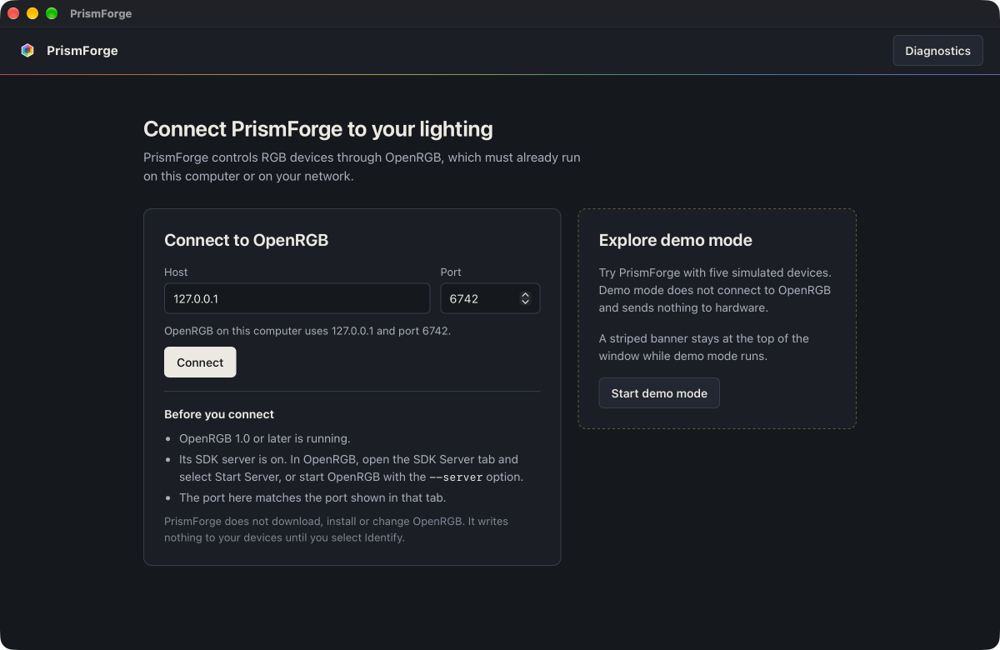

# PrismForge

PrismForge is a free, open-source desktop application for RGB lighting control. It uses a running [OpenRGB](https://openrgb.org) server for all hardware access.

PrismForge has no subscription, no account, no advertisements and no telemetry.

## Status

PrismForge is at an early stage. The desktop app shows the connection, the devices that OpenRGB reports, and an identify action. Its effects screen runs the six built-in effects on a device or zone. Its profiles screen saves the lighting as profiles on this computer, applies them, and exports and imports them. Devices and zones can have your own names. It has no layout yet.

| Part | Status |
|---|---|
| OpenRGB SDK client (protocol 6, OpenRGB 1.0 and later) | Built. Tested against a scripted fake server only. |
| Device identity that survives an OpenRGB restart | Built. Tested against a scripted fake server only. |
| Desktop app: connection, device list, identify, diagnostics, demo mode | Built. Run by hand on macOS (Apple Silicon) only. |
| Window: navigation rail, status strip, one notice slot, design tokens, keyboard shortcuts | Built. Tested in interface tests and looked at in a browser preview with simulated data. Not run in the native window or on Windows. |
| Windows build of the desktop app | Built and tested in CI on `windows-latest`: format, lint, all tests, typecheck and the unsigned installers. |
| Run of the desktop app on Windows | **Not done** |
| Test against a real OpenRGB server | **Not done** |
| Test on real hardware | **Not done** |
| Effect engine: six original effects, output scheduler at 30 FPS, output ownership | Built in Rust. Tested with the demo backend and the fake server in simulated time only. |
| Effects screen: targets, generated parameter controls, preview, apply and stop, hardware modes, another program's control, frame rate | Built. Run by hand in demo mode on macOS (Apple Silicon) through the accessibility tree only. |
| Effects plugin provider, performance measurements | Not started |
| Profiles in the Rust core: versioned files, backups and recovery, device registry on disk, capture, apply with a result per setting, export and import without private data | Built. Tested on real files in temporary folders with the demo backend and the fake server only. |
| Profiles screen in the app: save, update with a change list, apply with a result per setting, rename, duplicate, delete, export, import, apply on connect, repaired-file notices; device and zone names | Built. Tested through the shell and the interface tests only. Native dialogs not run by hand. |
| Tray, close or quit, one instance, start with the system, start hidden, connect at start, Settings screen | Built. Tested through the shell with fake window and start-entry seams and in interface tests. Native macOS build only; not run by hand, not run on Windows. |
| Layout | Not started |

## Requirements

- Rust 1.99.0. `rust-toolchain.toml` selects it.
- For the desktop app: Node.js 22.22.2 or later and pnpm 10.33.0. On Windows, WebView2 (part of Windows 10 and 11).
- For a live test: OpenRGB 1.0 or later with the SDK server turned on.

## Build and test

```sh
cargo fmt --all --check
cargo clippy --workspace --all-targets -- -D warnings
cargo test --workspace
cargo test -p prismforge-desktop --features ts --test bindings
```

## Run the desktop app

```sh
cd apps/desktop
pnpm install --frozen-lockfile
pnpm typecheck
pnpm test
pnpm tauri:dev
```

`pnpm tauri:build` builds the native app and its installers into `target/release/bundle`. The build is not signed. `apps/desktop/README.md` lists every command, the generated files and the security settings.

The window has a rail on the left with Devices, Effects and Profiles, and Diagnostics and Settings at its foot. These stay the same whether PrismForge is connected or not. A status strip at the top shows the connection, the active profile with its unsaved changes, a profile that is being applied, and demo mode. Click a part of the strip for its details and actions, such as Rescan devices, Disconnect and Save changes. Messages that need your attention appear in one place under the strip. Ctrl+1 to Ctrl+3 (Command on macOS) open the areas, and Ctrl+, opens Settings.

The app starts on Devices, which shows the connection form. Nothing connects until you choose:

- **Connect to OpenRGB**: give the host and port of the OpenRGB SDK server. The default is `127.0.0.1` and `6742`.
- **Explore demo mode**: five simulated devices. A striped "Demo mode" marker in the status strip labels demo mode on every screen. Demo mode sends nothing to hardware.

After a connection, **Devices** shows the device list and identify. **Effects** runs an effect:

1. Choose a device or one of its zones. Each device shows its owner: none, a PrismForge effect, a hardware mode selected in PrismForge, or another program that you named.
2. Choose an effect and set its values. The controls come from the effect's definition. A preview shows the pattern, not the device.
3. Choose **Apply effect**. A PrismForge effect runs only while PrismForge runs and is connected. Quitting PrismForge stops its effects and asks OpenRGB to put back the earlier lighting.

**Profiles** keeps lighting for later:

- **Save as new profile** stores the effects, hardware modes, program statements and frame rate in use. Profiles are files on this computer. Nothing is saved to the devices.
- **Apply profile** sends the stored settings and lists each one as applied or skipped, with the reason. A device that is missing, identical to another one or changed is skipped and stays in the profile. PrismForge never moves a setting to a similar device.
- **Save changes** adds what you changed since you applied the profile. It shows the change list first. PrismForge links your changes to a profile only until you disconnect, switch between demo mode and OpenRGB, or close PrismForge; after that, apply the profile first.
- **Apply this profile when PrismForge connects** is off by default. When it is on, PrismForge applies the profile once each time you connect.
- **Export** writes a file without serial numbers or locations. **Import** adds a new profile and never replaces one.
- Demo mode has its own profiles. They never apply to real hardware.

**Settings** holds what PrismForge does when it starts and when you close the window:

- **When you close the window.** The first time you close it, PrismForge asks. "Keep running in the tray" hides the window; PrismForge and its effects keep running, and its tray icon (the menu bar on macOS) shows the window again. "Quit PrismForge" ends it. Without a tray, closing the window always quits.
- **Quit PrismForge** is in the tray menu, on Settings, in the macOS app menu, and on the keyboard (Command-Q on macOS, Ctrl+Q on Windows). It stops PrismForge effects, puts back the earlier lighting where it can, disconnects and ends the process. When the system ends PrismForge instead (Dock Quit on macOS, logging out, shutting down), PrismForge tries the same for up to 4 seconds; the system may end it sooner. Ending it in Task Manager or Activity Monitor puts nothing back.
- **When PrismForge starts**, in four steps, each off until you turn it on: 1. start PrismForge when you sign in; 2. start hidden in the tray; 3. connect to OpenRGB when PrismForge starts, at the address of your last Connect; 4. the profile marked "Apply this profile when PrismForge connects". With steps 1, 3 and 4 on, your lights change at system start without a click. Settings shows which profile that is.
- Starting PrismForge a second time shows the window of the one that runs.

Start with the system is always for your user only. Turn it off before you uninstall: the NSIS uninstaller removes the entry, the MSI does not. To remove it by hand on Windows, run `reg delete "HKCU\Software\Microsoft\Windows\CurrentVersion\Run" /v PrismForge /f`; on macOS, `rm ~/Library/LaunchAgents/PrismForge.plist`. An earlier build run as administrator may have added an entry for every user; Settings says so, and removing it needs `reg delete "HKLM\Software\Microsoft\Windows\CurrentVersion\Run" /v PrismForge /f` in a Command Prompt opened as administrator. `docs/decisions/0004-lifecycle.md` has the details.

On **Devices**, **Rename device** and **Rename zone** give your own names. They appear on every screen. Diagnostics keeps the reported names.

PrismForge cannot see other programs, such as the OpenRGB Effects plugin, and cannot stop them. If another program controls a device, say so on the effects screen. PrismForge then sends nothing to that device until you hand it back.



Only the connection screen has a screenshot so far. Screenshots of demo mode, a device with an identify outcome, diagnostics and a failed connection are still missing.

## Probe a real OpenRGB server

The probe lists devices, zones, modes and capabilities. It writes nothing to hardware unless you give both `--device` and `--color`.

```sh
cargo run -p prismforge-openrgb --example probe -- --host 127.0.0.1 --port 6742
cargo run -p prismforge-openrgb --example probe -- --device <ref from listing> --color ff8000 [--zone 0]
```

## Repository layout

| Path | Content |
|---|---|
| `crates/prismforge-effects` | The built-in effects as pure functions, their control definitions and instance validation. No input or output. |
| `crates/prismforge-core` | Device types, capabilities, errors, identity matching, backend contract, scene and ownership types, and the session with its output scheduler. |
| `crates/prismforge-openrgb` | OpenRGB SDK client and the adapter for the backend contract. |
| `crates/prismforge-testkit` | Scripted fake OpenRGB server, device fixtures for tests, and the simulated demo backend. |
| `apps/desktop` | Svelte and TypeScript interface. |
| `apps/desktop/src-tauri` | Tauri shell: commands, the view event, the window capability. |
| `.github/workflows/ci.yml` | Windows CI: format, lint, tests, drift checks and the unsigned native build. |
| `docs/decisions` | Decision records. |
| `docs/handover.md` | Current state, verification commands and next steps. |
| `docs/provenance.md` | Sources and reuse rules. |
| `docs/plans` | The implementation plan and the feasibility review. |
| `docs/screenshots` | Screenshots of the native app on macOS. |

## Licence

PrismForge is licensed under GPL-3.0-or-later. See `LICENSE` and `THIRD_PARTY_NOTICES.md`.

PrismForge is not part of OpenRGB or SignalRGB, and those projects do not endorse it.
